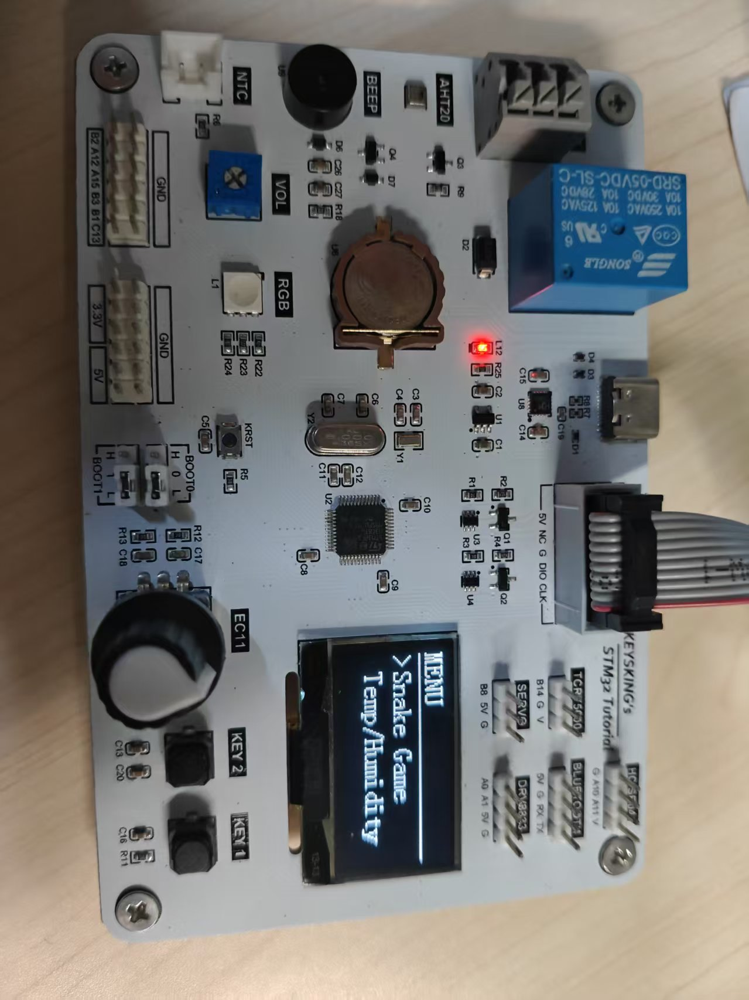
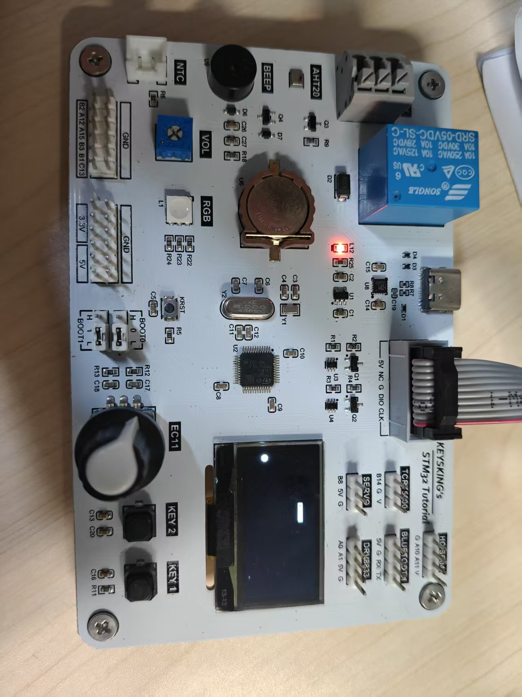

# 贪吃蛇 — STM32F103 + FreeRTOS + SSD1306

**简体中文** | [English](README.md)

跑在 **KEYSKING STM32 Tutorial** 开发板上的裸机贪吃蛇：
**128×64 I2C OLED** 显示，**EC11 旋转编码器** 转向，
**前 10 名最高分** 存片内 Flash（掉电不丢），另有一个
**温湿度显示界面**，与屏幕共用同一条 I2C 总线。

基于 STM32CubeMX + CMake + FreeRTOS（CMSIS-RTOS v2）构建。

---

## 做了什么

- **启动菜单** —— `Snake Game` / `Temp/Humidity`
- **贪吃蛇**
  - 32 × 16 棋盘（每格 4 × 4 像素），占满整屏
  - 初始长度 2，蛇头从屏幕中心出发，初始方向和食物都随机
  - 每秒移动一格（`OLEDTask.c` 里的 `SNAKE_TICK_MS`）
  - EC11 每格转向 90°
  - 只取两次移动之间的**净转动量**，所以拧多快都不会甩过头
  - 不可能 180° 掉头（踩到脖子直接判死）
  - 吃到食物长度 +1、得分 +1
  - 撞墙或撞到自己游戏结束
- **最高分** —— 前 10 名存在 Flash 最后一页，开机 magic + 校验和自动校验；列表带选择光标，可上下翻看
- **温湿度界面** —— AHT20/AHT10，每 2 秒采样一次，与屏幕共用 I2C1
- **按键驱动** —— 消抖 + 事件化（短按 / 长按），通过 FreeRTOS 消息队列投递
- **总线仲裁** —— 用互斥量把屏幕和传感器的 I2C1 访问串行化
- **Flash 安全** —— `goto cleanup` 保证 `HAL_FLASHEx_Erase` 或 `HAL_FLASH_Program` 中途失败时依然执行 `HAL_FLASH_Lock`

---

## 硬件

### 开发板

**KEYSKING STM32 Tutorial** —— STM32F103C8T6，LQFP48 封装。


*贪吃蛇启动菜单运行在板载 128×64 I2C OLED 上。*


*开发板全貌 —— 本项目只用到 OLED、EC11 编码器和 KEY1/KEY2。*

### MCU

| 项目 | 值 |
|---|---|
| 内核 | ARM Cortex-M3，72 MHz |
| Flash | 64 KB（最后 1 KB 页预留给最高分） |
| RAM | 20 KB |
| 晶振 | 8 MHz HSE，PLL × 9 → 72 MHz SYSCLK |
| 调试 | SWD（PA13 / PA14） |

### 本项目用到的外设

| 模块 | 接口 | 引脚 / 地址 | 备注 |
|---|---|---|---|
| SSD1306 OLED | I2C1 | PB6 = SCL，PB7 = SDA，`0x3C` | 128×64，100 kHz |
| AHT20 / AHT10 | I2C1（共用） | PB6 / PB7，`0x38` | 2 秒采样一次 |
| EC11 编码器 | TIM1 编码器模式 TI12 | PA8 = CH1，PA9 = CH2 | 4 计数 / 格，输入滤波 15 |
| KEY1 | GPIO 输入，上拉，低有效 | PB12 | 短按 / 长按 |
| KEY2 | GPIO 输入，上拉，低有效 | PB13 | 短按 / 长按 |

### 完整引脚分配

```
PA8  ── TIM1_CH1   (EC11 编码器 A 相)
PA9  ── TIM1_CH2   (EC11 编码器 B 相)
PA13 ── SWDIO      (ST-Link 调试)
PA14 ── SWCLK      (ST-Link 调试)
PB6  ── I2C1_SCL   (OLED SCL + AHT20 SCL)
PB7  ── I2C1_SDA   (OLED SDA + AHT20 SDA)
PB12 ── KEY1       (上拉，低有效)
PB13 ── KEY2       (上拉，低有效)
PD0  ── HSE_IN     (8 MHz 晶振)
PD1  ── HSE_OUT    (8 MHz 晶振)
```

### 板载但 **未使用** 的外设

KEYSKING 开发板还带了很多模块，本项目只用到了上面 5 个：

| 模块 | 说明 |
|---|---|
| NTC | 热敏电阻，分压采样 |
| BEEP | 有源蜂鸣器 |
| VOL | 电位器 |
| RGB | WS2812 或类似可寻址 LED |
| RELAY | SRD-05VDC-SL-C 5 V 继电器 |
| SERVO | RC 舵机接口 |
| TCRT5000 | 红外循迹传感器 |
| BLUE | 蓝牙模块座（HC-05 / CH340） |
| DRV8833 | 双 H 桥电机驱动 |
| HC-SR04 | 超声波测距 |

这些排针和电源已经接好，不需要改贪吃蛇代码就能接上去。

---

## 操作说明

### 主菜单

| 输入 | 动作 |
|---|---|
| KEY1 短按 | 选择项下移 |
| KEY2 短按 | 选择项上移 |
| KEY1 长按 | 进入所选界面 |

### 贪吃蛇菜单

| 输入 | 动作 |
|---|---|
| KEY1 短按 | 下一条最高分记录 |
| KEY1 长按 | 上一条最高分记录 |
| KEY2 短按 | **开始游戏** |

### 游戏中

| 输入 | 动作 |
|---|---|
| EC11 顺时针 | 右转 90° |
| EC11 逆时针 | 左转 90° |
| KEY1 长按 | 中止游戏，返回游戏菜单 |
| 自动 | 每秒前进一格 |

游戏结束后记录本局得分，屏幕显示 `GAME OVER` 2 秒，然后回到最高分列表。

### 温湿度界面

| 输入 | 动作 |
|---|---|
| 任意键 | 返回主菜单 |

---

## 软件结构

### FreeRTOS 对象

| 对象 | 类型 | 栈大小 | 备注 |
|---|---|---|---|
| `defaultTask` | 任务 | 128 字 | CubeMX 自动生成的空壳，未使用 |
| `myOLEDTasj` | 任务 —— UI 状态机、绘制、游戏主循环 | **256 字** | 栈消耗最大（`OLED_ShowFrame` 里的 HAL I2C） |
| `myKEYTask` | 任务 —— 按键消抖与事件生成 | 128 字 | |
| `myTempTask` | 任务 —— AHT2x 采样 | 128 字 | HAL I2C 调用 |
| `myEncoderTask` | 任务 —— TIM1 计数轮询 | 128 字 | |
| `KEY1Queue`、`KEY2Queue` | 消息队列，8 × `uint16_t` | — | 队列满时直接丢弃（非阻塞 put） |
| `I2C1Mutex` | 互斥量，带优先级继承 | — | 串行化 OLED ↔ AHT20 的 I2C1 访问 |

`configTOTAL_HEAP_SIZE = 8192` 字节 —— 5 个任务 + 定时器服务任务 + 2 个队列 + 1 个互斥量 + 空闲任务。**不要随便调小**，先跑 `uxTaskGetStackHighWaterMark` 实测。

### 并发安全速查表

| 共享数据 | 写入方 | 读取方 | 保护方式 |
|---|---|---|---|
| `s_counts`（编码器） | EncoderTask | OLEDTask | `volatile` + `__disable_irq` + 读即清零（不是读-改-写） |
| `s_data` / `s_seq`（温度） | TempTask | OLEDTask | `volatile` + 临界区内快照到局部变量，关中断后再交给调用方 |
| Snake 状态（`s_body` / `s_dir` / …） | OLEDTask（游戏循环） | OLEDTask（绘制） | 单任务，无竞态 |
| Score RAM（`s_blob`） | OLEDTask（死亡时） | OLEDTask（菜单） | 单任务，无竞态 |
| I2C1 总线 | OLEDTask + TempTask | — | `I2C1Mutex`（FreeRTOS） |
| Flash 寄存器 | `blob_save` | — | 单任务 + `goto cleanup` 保证所有 exit path 都执行 `HAL_FLASH_Lock` |

### 设计要点

- **屏幕单一所有者**：只有 UI 任务操作显存（`OLED_GRAM`），绘制不需要加锁；只有真正走 I2C 的 `OLED_ShowFrame()` 才被总线互斥量包住。
- **按键事件化**：按键任务只产生 `KEY_EVT_SHORT` / `KEY_EVT_LONG` 事件，UI 侧不轮询 GPIO。
- **编码器每次移动只采样一次**：`ENCODER_TakeSteps()` 返回距上次调用的净格数，输入多少都不影响结果。
- **游戏逻辑纯函数化**：`Snake.c` 不依赖任何硬件和 RTOS，就是一个网格状态机，由 UI 任务驱动。

---

## 目录结构

```
Snake_Game/
├─ Core/
│  ├─ Inc/
│  │  ├─ EncoderTask.h      编码器任务接口
│  │  ├─ I2CBus.h           I2C1Bus_Lock() / I2C1Bus_Unlock()
│  │  ├─ KEYTask.h          按键事件与队列句柄
│  │  ├─ Score.h            最高分表（前 10）
│  │  ├─ Snake.h            贪吃蛇逻辑
│  │  ├─ TempTask.h         传感器数据接口
│  │  ├─ oled.h / font.h    SSD1306 驱动 + 字库（波特律动）
│  │  └─ CubeMX 生成         main.h、i2c.h、gpio.h、tim.h、FreeRTOSConfig.h
│  └─ Src/
│     ├─ Game/
│     │  ├─ Snake.c         网格、方向、食物、碰撞（无 HAL / 无 OS 依赖）
│     │  └─ Score.c         前 10 + Flash 持久化（goto cleanup 安全退出）
│     ├─ Task/
│     │  ├─ I2C.c           I2C1Bus_Lock / I2C1Bus_Unlock（包装 I2C1Mutex）
│     │  ├─ EncoderTask.c   TIM1 编码器轮询 + 原子 s_counts
│     │  ├─ KEYTask.c       按键状态机、消抖、事件分发
│     │  └─ I2C/
│     │     ├─ OLEDTask.c   UI 状态机、各页面、游戏主循环
│     │     └─ TempTask.c   AHT2x 驱动、快照安全的 s_data / s_seq
│     ├─ oled.c / font.c    SSD1306 驱动 + 8×6 / 16×8 字模
│     └─ CubeMX 生成         main.c、gpio.c、i2c.c、tim.c、freertos.c、MSP 文件
├─ Drivers/                  STM32Cube HAL + CMSIS
├─ Middlewares/              FreeRTOS（CMSIS-RTOS v2）
├─ CMakeLists.txt            （和 CMakePresets.json）
├─ Snake_Game.ioc            ← 用 STM32CubeMX 打开即可改引脚、时钟、RTOS 对象
├─ STM32F103XX_FLASH.ld      链接脚本
└─ startup_stm32f103xb.s
```

---

## 构建

需要：`arm-none-eabi-gcc`、CMake ≥ 3.22、Ninja
（安装 STM32 的 VS Code 扩展会自带这三样）。

```bash
cmake --preset Debug
cmake --build --preset Debug
```

产物在 `build/Debug/Snake_Game.elf`，`Release` 用法相同。

在装了 CMake Tools 扩展的 VS Code 里，直接点状态栏的 **Build** 即可。

---

## 烧录与调试

### VS Code 一键任务

仓库自带 `.vscode/tasks.json`：

- `Ctrl+Shift+B` → 先编译再烧录（默认构建任务）

### 终端（ST-Link V2 + OpenOCD）

```bash
openocd -f interface/stlink.cfg -c "transport select swd" \
        -f target/stm32f1x.cfg \
        -c "program {build/Debug/Snake_Game.elf} verify reset exit"
```

> `-c` 后面的字符串由 Tcl 解析，路径必须用花括号 `{...}` 包住（或者用正斜杠），否则反斜杠会被当成转义符吃掉。

### Flash 占用

```
段         大小
.text      ~31 KB   ← 代码 + 只读常量
.data      极小
.bss       ~2 KB     ← OLED_GRAM + RTOS 空闲任务 + 全局变量
──────────────────────
合计       ~33 KB   Flash 占用，20 KB RAM
```

---

## 调参与注意事项

1. **CubeMX 里 SYS → Debug 必须保持 Serial Wire**。如果设成 `No_Debug`，生成的 `HAL_MspInit()` 会调用 `__HAL_AFIO_REMAP_SWJ_DISABLE()`，芯片一上电就关掉 SWD，之后只能靠 `BOOT0 = 1` 进内置 bootloader 才能救回来。
2. **任务入口函数名必须完全一致**。CubeMX 为每个任务生成一个 `__weak` 空实现，只有同名强函数才能覆盖它（`StartOLEDTask`、`StartKEYTask`、`StartTempTask`、`StartEncoderTask`）。
3. **`configTOTAL_HEAP_SIZE = 8192`** 要在 *FREERTOS → Config parameters* 里设置，否则重新生成代码会把 `FreeRTOSConfig.h` 改回默认值。
4. **最高分存在 `0x0800FC00`**（最后一页 1 KB）。固件要保持在 **63 KB 以内**，目前约 33 KB，很安全。
5. **编码器调参**都在 `Core/Src/Task/EncoderTask.c`：
   - `ENCODER_COUNTS_PER_STEP`（默认 **4**）：一格机械转动 = 4 个 TIM1 计数。拧一格转两次改成 2，拧好几格才转一次改成 8。
   - `ENCODER_INVERT`（默认 **1**）：翻转顺 / 逆时针。
   - `ENCODER_SCAN_MS`（默认 **100**）：轮询周期。10 ms 响应更快，200 ms 省 CPU。
6. **并发变量必须加 `volatile`**。`s_counts`、`s_data`、`s_seq` 都在任务间共享并且在 `__disable_irq` 临界区内读写。不加 `volatile` 编译器可能把它们缓存到寄存器里，把读取优化掉。
7. **Flash Unlock → Lock 不能少**。`blob_save()` 用 `goto cleanup` 保证 `HAL_FLASHEx_Erase` 或 `HAL_FLASH_Program` 返回 `HAL_ERROR` 时依然执行 `HAL_FLASH_Lock`。漏关锁会让 Flash 一直保持可写——一次 I2C 毛刺就可能污染代码区。
8. **游戏速度**：`OLEDTask.c` 里的 `SNAKE_TICK_MS` 是 **1000 ms**（每秒一格），改成 400~500 ms 更接近经典贪吃蛇的手感。
9. **I2C 目前跑 100 kHz**，整屏刷新约 93 ms。若 OLED 模块上拉 ≥ 4.7 kΩ，在 CubeMX 里把 I2C1 改到 400 kHz 界面会明显跟手。
10. **字库里没有汉字**。`zh16x16` 只包含几个字，所以界面用英文。需要中文的话，用 <https://led.baud-dance.com> 重新生成 `Core/Src/font.c`（16×16，所有字一次性生成）。

---

## 致谢

- **波特律动（Baud Dance）OLED 库** —— `oled.c` 驱动和 `font.c` 字模流水线。
- **STM32CubeMX** —— HAL 初始化、FreeRTOS 对象、CMake 骨架。
- **KEYSKING** —— 本项目使用的 STM32 Tutorial 开发板。

---

## 许可证

MIT —— 见仓库根目录的 `LICENSE` 文件。